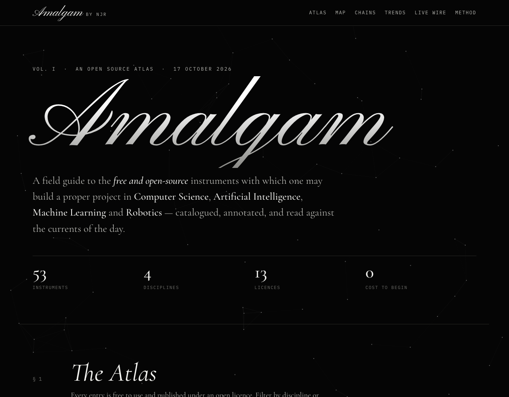
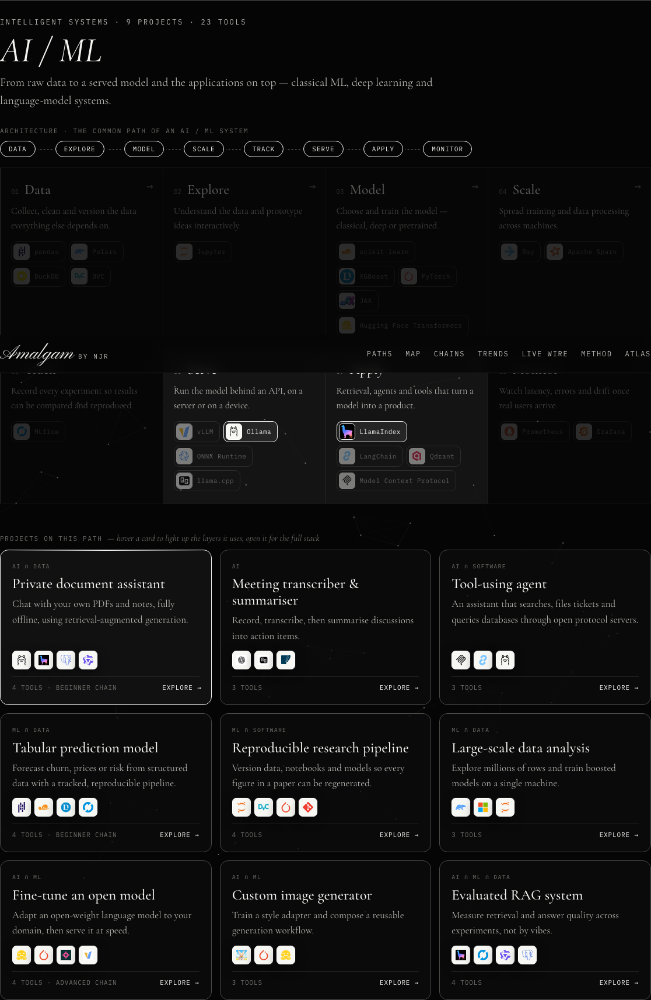
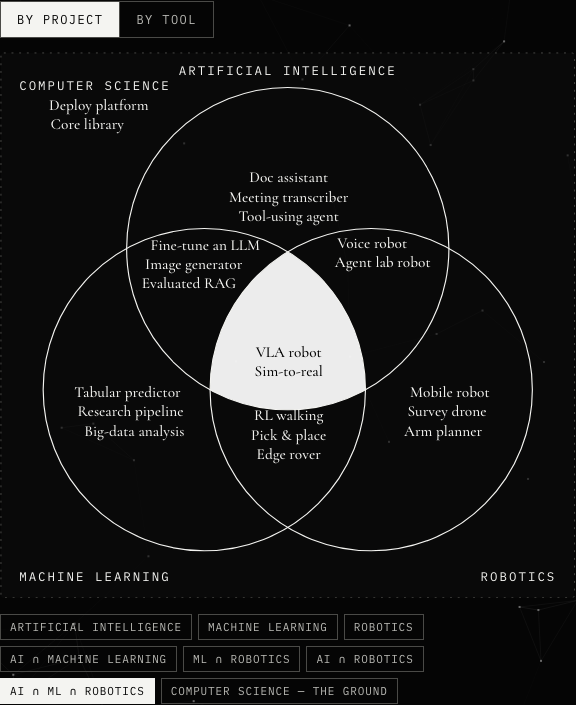
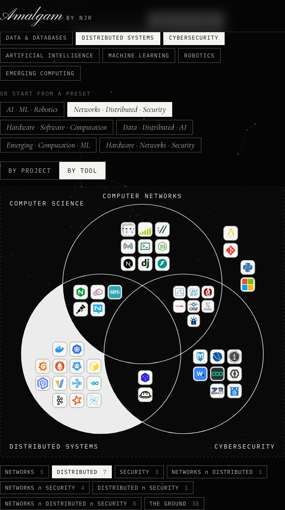
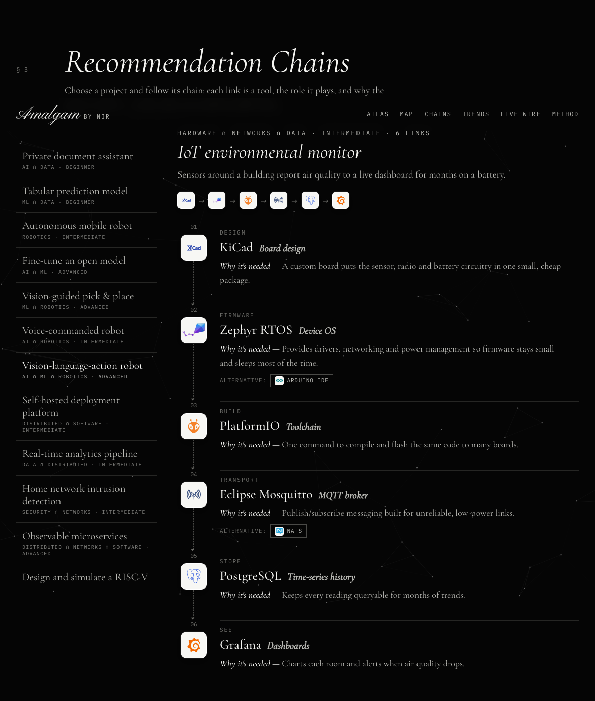

<div align="center">

# Amalgam · by NJR

### An Open Source Atlas across eleven domains of Computer Science

**🔗 Live site → [amalgambynjr.vercel.app](https://amalgambynjr.vercel.app)**

[](https://amalgambynjr.vercel.app)




</div>

---

## About

**Amalgam** is a research-style field guide to building real projects with **only free, open-source tools**. Start from what you want to build (a web app, a mobile app, an AI/ML system, a robot), see the **common architecture** for that kind of project with the open tools for every layer, and explore project recipes across **eleven domains of computer science**, alongside **current trends and live news**:

> Hardware · Software · Computation · Computer Networks · Data & Databases · Distributed Systems · Cybersecurity · Artificial Intelligence · Machine Learning · Robotics · Emerging Computing

A real project is rarely one tool, or one domain. It is an *amalgam*: ROS 2 braided with MuJoCo and PyTorch, or an IoT monitor built from KiCad, Zephyr, MQTT and Grafana across hardware, networks and data. This site catalogues those parts, shows which combinations produce which kinds of projects, and keeps you current with what is happening in the field.

The design is futuristic and monochrome, with black and white throughout and only the tool logos in colour. A calligraphic chrome title, with a moving sheen and an outline echo that follows the pointer, sits over a live canvas scene: a depth starfield, a rotating point-cloud globe with orbiting satellites, and a perspective grid running to a glowing horizon that moves as you scroll. Scanlines and grain sit over the scene, and on-screen readouts (live clock, typed boot line, counting stats) frame the title. Section text is set in a classical serif in the style of a research paper. Everything respects `prefers-reduced-motion`.

## Features

| Section | What it does |
|---|---|
| **§1 Build Paths** | Start here. Choose a path: **Software Engineering → Web applications / Mobile applications**, **AI / ML**, **Robotics**, then Data, Distributed systems, Networks, Security, Hardware, Computation and Emerging computing. Each path shows its **common-path architecture**: the layers a typical project passes through (e.g. *Interface → Build & style → Server & API → Data → Identity → Test → Deliver → Observe*), with the open-source tools for every layer. Below it are **explorable project cards**; hover one to light up the layers and tools it uses, or open it in a drawer showing the full stack, each tool's role and why it's needed, where it sits in the architecture, and links to its chain and its place on the map. |
| **§2 The Amalgam Map** | An interactive **Venn diagram of any three domains**, picked by hand or from presets. Each project and tool lands in the overlap matching its domains. **By project** writes project names inside each region; **by tool** places tool logos there, with *+N more* when a region is crowded. |
| **§3 Recommendation Chains** | Step-by-step tool chains for 20 projects. Every link names the tool, the **role** it plays, **why the project needs it**, and an alternative. |
| **§4 Currents & Trends** | Twelve movements across the field, each linked to its tools. |
| **§5 Method** | How tools were chosen: open-source licences only, no paid plans, and open community forks where a project left open source. |
| **§6 The Atlas** | The full catalogue at the bottom: 141 open-source tools with logos, licences and domains. Filter by domain or search; every card opens the tool drawer. |

Clicking a tool anywhere on the site opens a drawer with its licence, domains, its layer in each build path, and every project that uses it.

**Live Wire pop-up.** A rotating half-circle on the right edge of the screen, with *LIVE NEWS* circling it, a radar sweep and a glowing core, opens a compact pop-up that unfolds out of it with live headlines from the Hacker News index. You can also open it from *Live news* in the nav; Esc or a click outside closes it. It covers All, AI, Machine Learning, Robotics, Security, Networking, Databases, Distributed, Hardware, Quantum and Open Source, and refreshes every minute while the page is visible. Headlines that arrive between refreshes are marked **NEW**, and while the pop-up is closed the half-circle shows a count of unread headlines. On phones the half-circle sits in the bottom-right corner.



| By project | By tool |
|---|---|
|  |  |

### Example chain: Voice-commanded robot



| # | Stage | Tool | Role | Why it's needed |
|---|---|---|---|---|
| 1 | Hear | Whisper | Speech to text | Turns spoken commands into text, offline |
| 2 | Understand | Qwen | Language understanding | Converts free-form speech into a structured goal |
| 3 | Host | Ollama | On-board model server | Runs the model locally on the robot with no network needed |
| 4 | Connect | Model Context Protocol | Tool bridge | Lets the model call only the robot actions you allow |
| 5 | Dispatch | ROS 2 | Robot middleware | Routes the goal to the navigation stack |
| 6 | Move | Nav2 | Navigation | Drives to the location around obstacles |

### Example projects across the domains

| Domains | Project | Recipe |
|---|---|---|
| Hardware ∩ Computation | Design and simulate a RISC-V core | Git + Verilator + Yosys + OpenROAD |
| Hardware ∩ Networks ∩ Data | IoT environmental monitor | KiCad + Zephyr + PlatformIO + Mosquitto + PostgreSQL + Grafana |
| Software ∩ Data ∩ Networks | Full-stack web app | TypeScript + React + Node.js + PostgreSQL + Caddy + Docker |
| Computation ∩ Software | Formally verified algorithm | Lean 4 + Z3 + Rust |
| Networks ∩ Computation | Network lab on a laptop | Mininet + Wireshark + ns-3 |
| Data ∩ Distributed | Real-time analytics pipeline | Kafka + Spark + ClickHouse + Airflow + Grafana |
| Distributed ∩ Networks ∩ Software | Observable microservices | Go + gRPC + Envoy + Kubernetes + OpenTelemetry + Prometheus + Grafana |
| Security ∩ Networks | Home network intrusion detection | Linux + Zeek + Suricata + Wazuh + Grafana |
| Security ∩ Software ∩ Distributed | Secure CI/CD pipeline | Git + Semgrep + Docker + Trivy + OpenBao |
| AI ∩ Data | Private document assistant | Ollama + LlamaIndex + PostgreSQL + Qwen |
| AI ∩ ML ∩ Robotics | Vision-language-action robot | LeRobot + PyTorch + Transformers + MuJoCo + ROS 2 |
| Emerging ∩ Computation | Quantum algorithms playground | Jupyter + Qiskit + Cirq + QuTiP |
| Emerging ∩ ML ∩ Robotics | Spiking-network robot controller | snnTorch + Lava + ROS 2 + Gazebo |

## Tech stack

Plain **HTML, CSS and vanilla JavaScript**, with no framework and no build step.

- **Fonts:** Pinyon Script (calligraphy), Cormorant Garamond (research serif), IBM Plex Mono (instrument labels), from Google Fonts
- **Logos:** [Simple Icons](https://simpleicons.org) glyphs (CC0) and project GitHub avatars, stored in the repo. Logos are trademarks of their respective projects.
- **Venn diagram:** hand-built SVG using clip paths and masks to paint each exact intersection
- **Background:** hand-written Canvas 2D scene (starfield, 3D point-cloud globe, perspective grid) at about 60 fps, with no libraries; it renders a single still frame when `prefers-reduced-motion` is set
- **News:** [Hacker News Algolia API](https://hn.algolia.com/api), with no API key needed
- **Hosting:** [Vercel](https://vercel.com)

## Project structure

```
├── index.html   # Page structure and sections
├── styles.css   # Monochrome, research-style design
├── data.js      # Domains, build tracks, architectures, tools, projects, chains, trends, map presets, news topics
├── app.js       # Atlas filtering, Venn map, chains, live wire, background animation
├── logos/       # Self-hosted tool logos
└── docs/        # README screenshots
```

## Run locally

```bash
git clone https://github.com/NJROzzy/Opensourcetools.git
cd Opensourcetools
python3 -m http.server 8000
# open http://localhost:8000
```

## Contributing a tool or recipe

All content lives in **`data.js`**.

- **Domains:** `hardware`, `software`, `computation`, `networks`, `data`, `distributed`, `security`, `ai`, `ml`, `robotics`, `emerging`.
- **Add a tool:** append to `tools` with `domains` (primary first, then any others it serves), `name`, `logo`, `kind`, `license`, `url` and `desc`. Set `foundation: true` for tools every project relies on; they sit on the map's ground when none of their domains is chosen.
- **Add a project:** append to `projects` with its `track` (build path), `name`, a `short` label for the map, its `domains`, `desc` and `tools`. Tool names must exactly match a tool's `name`. The path, the drawer and the map pick it up automatically.
- **Edit an architecture:** each build path's common path lives in `architectures[track].stages` as `{ name, role, tools }`, in order.
- **Add a chain:** append to `chains` with `project` (matching a project name), `level`, `goal` and ordered `steps` of `{ stage, tool, role, why, alt? }`.
- **Add a map preset:** append `{ name, domains: [three ids] }` to `venn.presets`.
- **Logos:** put the file in `logos/` and set the tool's `logo` path. Logos are shown in full colour on light tiles; tools without one get a lettered tile.
- Only include tools that are **free to use** and published under an **open-source licence**. No paid plans or proprietary services.

## Deploy

```bash
vercel deploy --prod
```

---

<div align="center">

**[amalgambynjr.vercel.app](https://amalgambynjr.vercel.app)**

Compiled by **NJR**

*Licences change. Always verify the licence file in a project's repository before you build upon it.*

</div>
