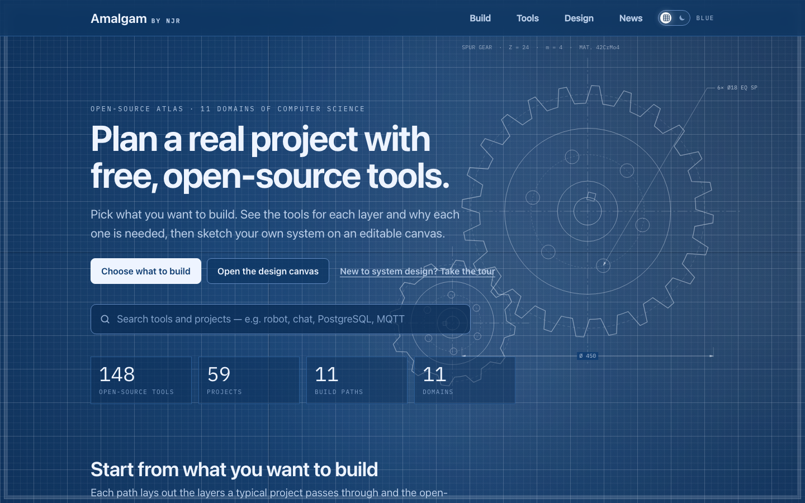
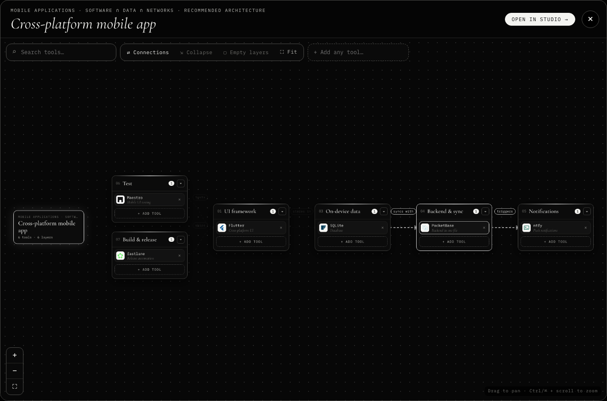
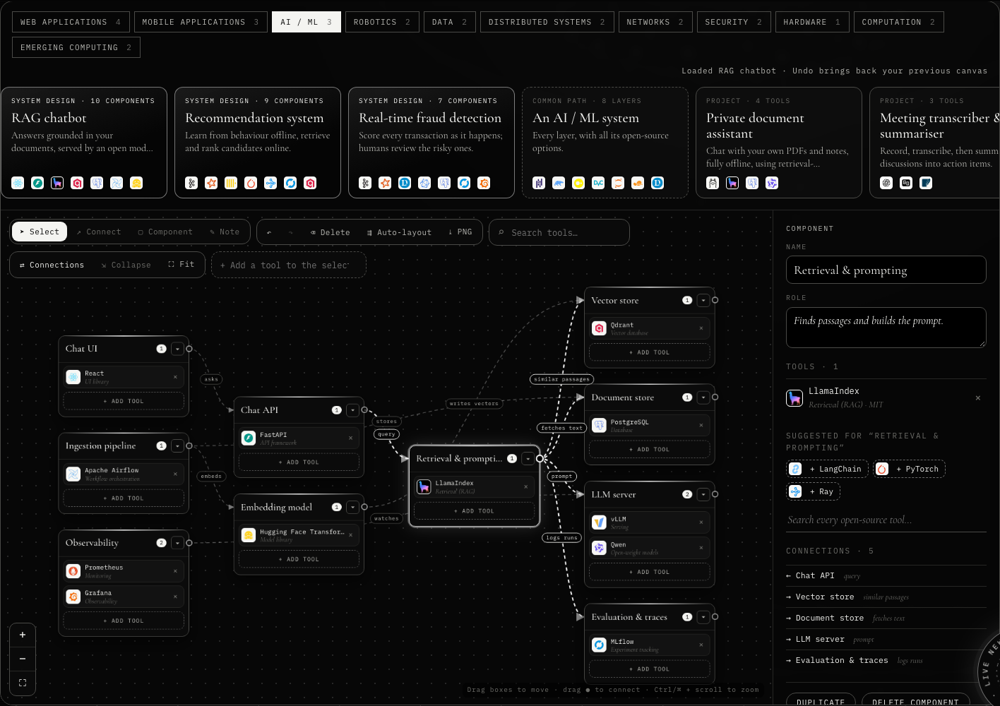
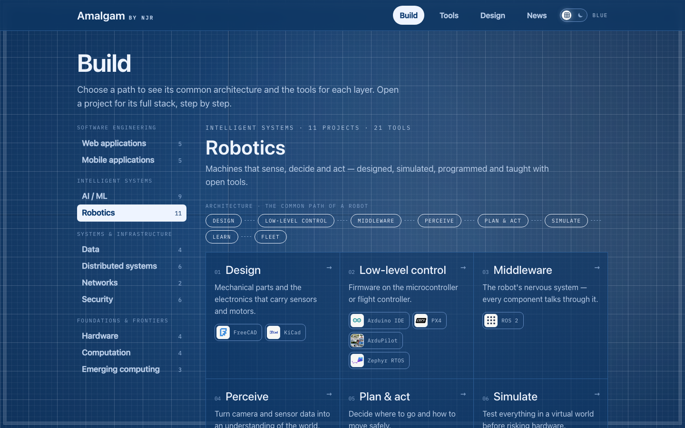
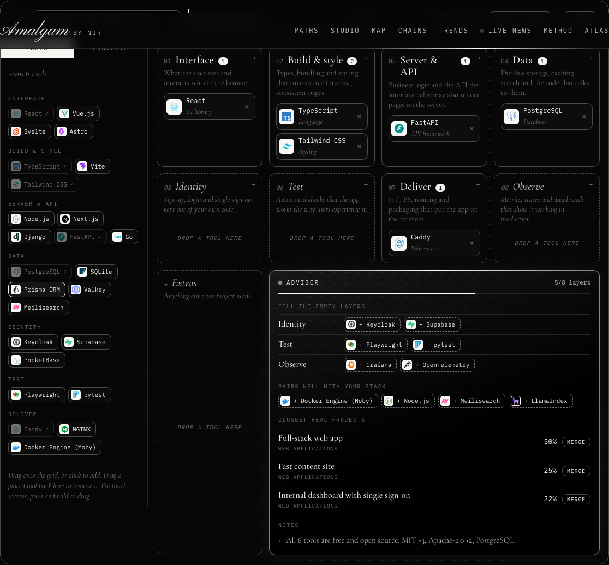
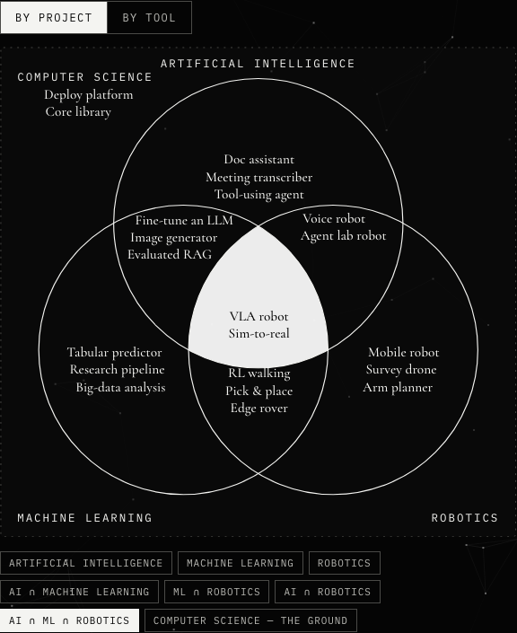
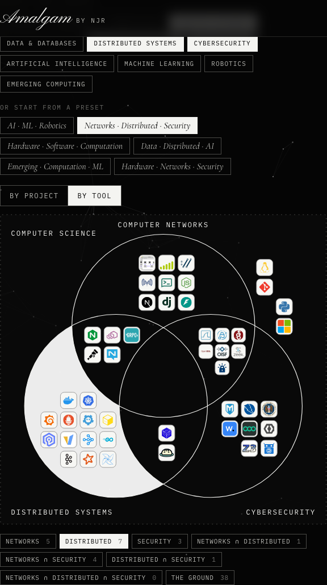
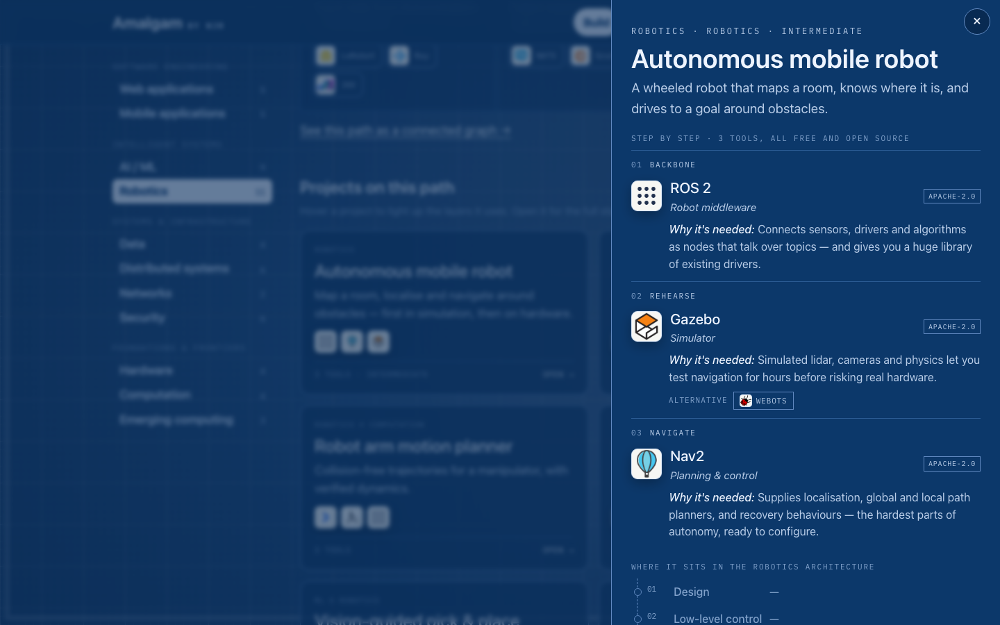

<div align="center">

# Amalgam · by NJR

### An Open Source Atlas across eleven domains of Computer Science

**🔗 Live site → [amalgambynjr.vercel.app](https://amalgambynjr.vercel.app)**

[](https://amalgambynjr.vercel.app)




</div>

---

## About

**Amalgam** helps students, developers, and curious builders turn an idea into a system using free, open-source tools. It connects project recipes to editable architecture diagrams so you can see what each tool does, how the pieces fit together, and how the design can grow as usage increases.

The site covers eleven domains of computer science.

> Hardware · Software · Computation · Computer Networks · Data & Databases · Distributed Systems · Cybersecurity · Artificial Intelligence · Machine Learning · Robotics · Emerging Computing

The design is an **engineering drawing sheet**. Both themes use light line work on drafting paper, with a classic Prussian-blue **blueprint** and a neutral **black** option. The background is a live Canvas drawing: fine and major grid lines on mottled, folded paper, with technical drawings that drift past as you scroll. They include a spur gear meshing with a pinion, a bearing cross-section with hatching, an isometric enclosure with hidden edges, a moving 2-DOF robot-arm linkage and PCB traces, all with centre lines, dimensions and callouts. A drafting crosshair with X/Y coordinates follows the mouse. The page sits inside a double sheet border, and the footer is a drawing title block (title, drawn by, dwg no., scale, sheet, rev, date). Everything respects `prefers-reduced-motion`.

**Blue and black.** Amalgam opens in blue by default. Use the theme switch in the header to switch backgrounds. The browser remembers your choice and applies it before the first paint. The selected palette also applies to the graphs, Live Wire, and exported PNGs.

## Getting started

The homepage introduces Amalgam with a shared to-do list. Start with three components, follow a task from browser to database, and see how to grow the design as usage increases.

Choose what you want to build to open the **System Design Canvas** with that topic selected. Pick a starter design or choose **Blank canvas** to draw your own. **Explore the full site** opens the other sections.

Direct links open their section. The footer’s **Read the introduction** button reopens the welcome.

### Build your first architecture

1. In **System Design Canvas**, choose a domain and load a ready-made design, a build path's common architecture, or a recommended project.
2. Select a component to edit its role and tools in the **Inspector**. Drag components to reposition them, or drag from a component's connection port to link it to another.
3. Select the empty canvas to show **Copy as text** and **Download PNG** in the Inspector. The canvas saves your edits in the current browser.
4. To assemble a stack by layer, open a path or project's architecture graph and choose **Open in Studio**. The graph also offers **Edit on the canvas** for diagram editing.

## Features

| Section | What it does |
|---|---|
| **§1 System Design Canvas** | An editable diagram for system designs. Start from **25 ready-made system designs** across all 11 domains (URL shortener, real-time chat, e-commerce, video streaming, ride-hailing, food delivery, RAG chatbot, recommendations, fraud detection, warehouse robot fleet, drone delivery, clickstream analytics, lakehouse, job platform, API gateway, CDN edge, IoT telemetry, zero-trust access, SOC pipeline, smart-home hub, optimisation service, quantum workflow and more), a path's common architecture, or any recommended project. **Editing tools:** Select & move (V), Connect (C, or drag a box's ● port), add Component (B) and Note (N), drag tools between components, Delete, Undo/Redo (⌘/Ctrl Z, ⇧⌘/Ctrl Z), Auto-layout, Fit, zoom and pan, and **Export PNG**. The **Inspector** renames components, edits roles and connection labels (with quick picks), reverses connections, duplicates components, and adds or removes tools, with suggestions based on a component's name and role. You can copy the design as text; it is saved in your browser. |
| **§2 Build Paths** | Choose a path: **Software Engineering → Web applications / Mobile applications**, **AI / ML**, **Robotics**, then Data, Distributed systems, Networks, Security, Hardware, Computation and Emerging computing. Each path shows its **common-path architecture**: the layers a typical project passes through (e.g. *Interface → Build & style → Server & API → Data → Identity → Test → Deliver → Observe*), with the open-source tools for every layer. Below it are **explorable project cards**; hover one to light up the layers and tools it uses, or open it in a drawer showing the full stack, each tool's role and why it's needed, where it sits in the architecture, and links to its chain and its place on the map. |
| **§3 Architecture Studio** | A drag-and-drop **grid** for assembling your own architecture. Pick a path and its layers become drop lanes (plus *Extras*). Drag tools from the palette into lanes, move them between lanes, or drag them back to remove them. You can also drop a whole **project** to load its stack (switching to its path), or simply click to add. An **Advisor** tile inside the grid recommends tools as you build: layer coverage, the best picks for empty layers, tools that pair well with yours (based on how often they appear together in the projects), the closest real projects with a match percentage, notes when a layer holds tools that do the same job, and a licence summary. Name it, copy it as text, or clear it; your board is saved in your browser. Works with mouse, pen and touch (press and hold to drag). |
| **§4 The Amalgam Map** | An interactive **Venn diagram of any three domains**, picked by hand or from presets. Each project and tool lands in the overlap matching its domains. **By project** writes project names inside each region; **by tool** places tool logos there, with *+N more* when a region is crowded. |
| **§5 Recommendation Chains** | Step-by-step tool chains for 20 projects. Every link names the tool, the **role** it plays, **why the project needs it**, and an alternative. |
| **§6 Currents & Trends** | Twelve movements across the field, each linked to its tools. |
| **§7 Method** | How tools were chosen: open-source licences only, no paid plans, and open community forks where a project left open source. |
| **§8 The Atlas** | The full catalogue at the bottom: 148 open-source tools with logos, licences and domains. Filter by domain or search; every card opens the tool drawer. |

**Architecture graphs.** Every project and every build path can be opened as a connected architecture graph, much like a node-graph editor. Layers are nodes ranked left to right by how they connect: "calls", "reads & writes", "verifies with", "deploys to" and so on, defined for all 11 paths. Tools sit inside their layers, and animated lines show how they connect. Search, *Connections*, *Collapse*, *Empty layers*, *Fit*, zoom (Ctrl/⌘ + scroll, pinch, or the buttons) and drag-to-pan are all there. Remove a tool with ×, add one from a layer's *+ add tool* (best fits first) or from *Add any tool*, compare against the original (*+2 added · −1 removed*, *Reset*), then *Open in Studio*. The Studio has the same graph as a *Graph* view of your board, alongside the grid, with *Undo*. On narrow screens the graph flows top to bottom, two layers per row.





Clicking a tool anywhere on the site opens a drawer with its licence, domains, its layer in each build path, and every project that uses it.

**Live Wire pop-up.** A rotating half-circle on the right edge of the screen, with *LIVE NEWS* circling it, a radar sweep and a glowing core, opens a compact pop-up that unfolds out of it with live headlines from the Hacker News index. You can also open it from *Live news* in the nav; Esc or a click outside closes it. It covers All, AI, Machine Learning, Robotics, Security, Networking, Databases, Distributed, Hardware, Quantum and Open Source, and refreshes every minute while the page is visible. Headlines that arrive between refreshes are marked **NEW**, and while the pop-up is closed the half-circle shows a count of unread headlines. On phones the half-circle sits in the bottom-right corner.





| By project | By tool |
|---|---|
|  |  |

### Example chain: Voice-commanded robot



| # | Stage | Tool | Role | Why it's needed |
|---|---|---|---|---|
| 1 | Hear | Whisper | Speech to text | Turns spoken commands into text, offline |
| 2 | Understand | Qwen | Language understanding | Converts free-form speech into a structured goal |
| 3 | Host | Ollama | On-board model server | Runs the model locally on the robot with no network needed |
| 4 | Connect | Model Context Protocol | Tool bridge | Lets the model call only the robot actions you allow |
| 5 | Dispatch | ROS 2 | Robot middleware | Routes the goal to the navigation stack |
| 6 | Move | Nav2 | Navigation | Drives to the location around obstacles |

### Example projects across the domains

| Domains | Project | Recipe |
|---|---|---|
| Hardware ∩ Computation | Design and simulate a RISC-V core | Git + Verilator + Yosys + OpenROAD |
| Hardware ∩ Networks ∩ Data | IoT environmental monitor | KiCad + Zephyr + PlatformIO + Mosquitto + PostgreSQL + Grafana |
| Software ∩ Data ∩ Networks | Full-stack web app | TypeScript + React + Node.js + PostgreSQL + Caddy + Docker |
| Computation ∩ Software | Formally verified algorithm | Lean 4 + Z3 + Rust |
| Networks ∩ Computation | Network lab on a laptop | Mininet + Wireshark + ns-3 |
| Data ∩ Distributed | Real-time analytics pipeline | Kafka + Spark + ClickHouse + Airflow + Grafana |
| Distributed ∩ Networks ∩ Software | Observable microservices | Go + gRPC + Envoy + Kubernetes + OpenTelemetry + Prometheus + Grafana |
| Security ∩ Networks | Home network intrusion detection | Linux + Zeek + Suricata + Wazuh + Grafana |
| Security ∩ Software ∩ Distributed | Secure CI/CD pipeline | Git + Semgrep + Docker + Trivy + OpenBao |
| AI ∩ Data | Private document assistant | Ollama + LlamaIndex + PostgreSQL + Qwen |
| AI ∩ ML ∩ Robotics | Vision-language-action robot | LeRobot + PyTorch + Transformers + MuJoCo + ROS 2 |
| Emerging ∩ Computation | Quantum algorithms playground | Jupyter + Qiskit + Cirq + QuTiP |
| Emerging ∩ ML ∩ Robotics | Spiking-network robot controller | snnTorch + Lava + ROS 2 + Gazebo |

## Tech stack

Plain **HTML, CSS and vanilla JavaScript**, with no framework and no build step.

- **Fonts:** System sans-serif for headings and body text, and IBM Plex Mono from Google Fonts for technical labels
- **Logos:** [Simple Icons](https://simpleicons.org) glyphs (CC0) and project GitHub avatars, stored in the repo. Logos are trademarks of their respective projects.
- **Venn diagram:** hand-built SVG using clip paths and masks to paint each exact intersection
- **Background:** hand-written Canvas 2D blueprint (grid paper, parametric gear/bearing/enclosure/arm/PCB drawings, crosshair) at about 60 fps, with no libraries; it renders a single still frame when `prefers-reduced-motion` is set
- **News:** [Hacker News Algolia API](https://hn.algolia.com/api), with no API key needed
- **Hosting:** [Vercel](https://vercel.com)

## Project structure

```
├── index.html   # Page structure and sections
├── intro.js     # Opens the homepage introduction and handles entry and replay
├── styles.css   # Blue and black themes, responsive layouts
├── data.js      # Domains, build tracks, architectures, tools, projects, chains, trends, map presets, news topics
├── app.js       # Paths, Studio, map, chains, drawers, live news, background animation
├── graph.js     # Architecture graph engine: layout, pan/zoom, viewing and full diagram editing, PNG export
├── logos/       # Self-hosted tool logos
└── docs/        # README screenshots
```

## Run locally

```bash
git clone https://github.com/NJROzzy/Opensourcetools.git
cd Opensourcetools
python3 -m http.server 8000
# open http://localhost:8000
```

The app runs as a static site. Your canvas, Studio board, and theme preference are stored in the browser for the current site address. Live Wire fetches headlines from Hacker News and needs an internet connection.

## Contributing a tool or recipe

All content lives in **`data.js`**.

- **Domains:** `hardware`, `software`, `computation`, `networks`, `data`, `distributed`, `security`, `ai`, `ml`, `robotics`, `emerging`.
- **Add a tool:** append to `tools` with `domains` (primary first, then any others it serves), `name`, `logo`, `kind`, `license`, `url` and `desc`. Set `foundation: true` for tools every project relies on; they sit on the map's ground when none of their domains is chosen.
- **Add a project:** append to `projects` with its `track` (build path), `name`, a `short` label for the map, its `domains`, `desc` and `tools`. Tool names must exactly match a tool's `name`. The path, the drawer and the map pick it up automatically.
- **Add a system design:** append to `designs` with `id`, `track`, `name`, `summary`, `nodes` (`{ id, name, role, tools }`) and `edges` (`{ from, to, label }`). It appears under its domain on the canvas.
- **Edit an architecture:** each build path's common path lives in `architectures[track].stages` as `{ name, role, tools }`, in order, and `architectures[track].links` lists how layers connect as `[from, to, "what it does"]`. Links must not form a cycle, because the graph ranks layers from them.
- **Add a chain:** append to `chains` with `project` (matching a project name), `level`, `goal` and ordered `steps` of `{ stage, tool, role, why, alt? }`.
- **Add a map preset:** append `{ name, domains: [three ids] }` to `venn.presets`.
- **Logos:** put the file in `logos/` and set the tool's `logo` path. Logos are shown in full colour on light tiles; tools without one get a lettered tile.
- Only include tools that are **free to use** and published under an **open-source licence**. No paid plans or proprietary services.

## Deploy

```bash
vercel deploy --prod
```

---

<div align="center">

**[amalgambynjr.vercel.app](https://amalgambynjr.vercel.app)**

Compiled by **NJR**

*Licences change. Always verify the licence file in a project's repository before you build upon it.*

</div>
